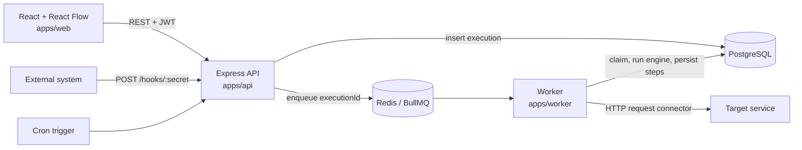

# FlowForge

A no-code workflow automation platform for small businesses. Design a workflow visually, save it as validated JSON, trigger it with a webhook or a schedule, and watch every step execute asynchronously with full logs.

> Portfolio project built in one month: React + TypeScript + React Flow on the front end, Node.js + Express + BullMQ + PostgreSQL + Redis on the back end.

<!-- **Live demo:** `<your-demo-url>`  |  **Demo video / screenshots:** `<add-link-or-images>` -->

---

## Table of contents

- [What it does](#what-it-does)
- [Demo flow](#demo-flow)
- [Architecture](#architecture)
- [Tech stack](#tech-stack)
- [Repository layout](#repository-layout)
- [Getting started](#getting-started)
- [The workflow DSL](#the-workflow-dsl)
- [Execution semantics](#execution-semantics)
- [API reference](#api-reference)
- [Reliability design](#reliability-design)
- [Security](#security)
- [Testing](#testing)
- [Deployment](#deployment)
- [Design decisions and trade-offs](#design-decisions-and-trade-offs)
- [Known limitations](#known-limitations)
- [Roadmap](#roadmap)

---

## What it does

1. A user designs a workflow on a visual canvas (React Flow).
2. The workflow is saved as JSON and validated against a strict schema.
3. A webhook or scheduled trigger starts the workflow.
4. A Redis-backed queue dispatches the execution to a separate worker process.
5. The execution engine interprets the workflow graph.
6. Connectors perform actions (HTTP request in the MVP).
7. Every step records a structured log entry.
8. The user reviews execution history and errors in the dashboard.

## Demo flow

The reference workflow shipped with the project:

```
Webhook trigger -> Condition (amount > 100) -> true:  HTTP request (high-value order)
                                            -> false: HTTP request (standard order)
```

1. Log in and open (or create) a workflow in the builder.
2. Activate it and copy its webhook URL.
3. Send an event:
   ```bash
   curl -X POST http://localhost:3001/hooks/<secret> \
     -H "Content-Type: application/json" \
     -H "Idempotency-Key: order-1001" \
     -d '{"amount": 150}'
   ```
4. The API answers `202 Accepted` immediately. The worker runs the workflow, takes the `true` branch, and records one log row per step.
5. Send the same request again with the same `Idempotency-Key`: the API returns the original execution with `"duplicate": true` and nothing runs twice.

## Architecture

FlowForge is a **modular monolith with a separate worker process**: one codebase, independently runnable and deployable processes, shared engine code.



Key points:

- **Jobs carry only an `executionId`.** The worker loads the definition and payload from Postgres, so Postgres stays the single source of truth and a redelivered job never carries stale data.
- **The engine is framework-independent.** `runWorkflow(definition, payload, { signal })` is a pure async function with no Express, Redis, or database imports, which makes it directly unit-testable.
- **Connectors are adapters** behind a stable shape (`config` in, `ActionExecutionResult` out). The HTTP request connector is the first.
- **The canvas is not the DSL.** React Flow state is converted to and from `WorkflowDefinition` by explicit, lossless converters, so UI concerns never leak into the engine.

## Tech stack

| Layer | Choice |
|---|---|
| Front end | React, TypeScript, Vite, React Flow (`@xyflow/react`) |
| API | Node.js, Express, TypeScript, Zod |
| Queue / worker | BullMQ on Redis, separate worker process |
| Database | PostgreSQL 16 (plain `pg` with hand-written SQL) |
| Migrations | `node-pg-migrate` |
| Auth | bcrypt password hashing, JWT |
| Tests | Vitest |
| Local dev | Docker Compose (Postgres and Redis) |
| CI/CD | GitHub Actions |
| Hosting | Vercel (web), Render or equivalent (API, worker, Postgres, Redis) |

## Repository layout

```
flowforge/
├── apps/
│   ├── api/                 Express API, DSL schema/validation, execution engine, migrations
│   │   ├── migrations/
│   │   └── src/
│   │       ├── auth/        register, login, JWT, auth middleware
│   │       ├── dsl/         Zod schema + graph validation
│   │       ├── engine/      runWorkflow, condition evaluator, connectors
│   │       ├── executions/  shared enqueueExecution
│   │       ├── hooks/       public webhook trigger
│   │       ├── queue/       BullMQ queue definition
│   │       └── workflows/   workflow CRUD + execute route
│   ├── worker/              BullMQ consumer that runs the engine and persists results
│   └── web/                 React app: login, canvas, node palette, config panel
├── docs/decisions.md        Architecture decision log
├── docker-compose.yml       Postgres 16 + Redis 7
└── .env.example
```

The worker and web app import the DSL types and engine from `apps/api/src` through relative paths. This is a deliberate shortcut for the MVP (see [trade-offs](#design-decisions-and-trade-offs)).

## Getting started

### Prerequisites

- Node.js 20.6 or newer (22+ recommended)
- Docker with Compose v2
- Git

### 1. Clone and install

```bash
git clone https://github.com/hail-dev/flowforge.git
cd flowforge
npm install
```

### 2. Configure the environment

```bash
cp .env.example .env
```

Replace `JWT_SECRET` with a long random value:

```bash
openssl rand -hex 32
```

| Variable | Purpose | Default in `.env.example` |
|---|---|---|
| `POSTGRES_USER`, `POSTGRES_PASSWORD`, `POSTGRES_DB`, `POSTGRES_PORT` | Postgres container settings | `flowforge` / dev password / `flowforge` / `5432` |
| `REDIS_PORT` | Redis container port | `6379` |
| `DATABASE_URL` | Postgres connection string for the apps | local Postgres |
| `REDIS_URL` | Redis connection string for the apps | `redis://localhost:6379` |
| `API_PORT` | API port | `3001` |
| `JWT_SECRET` | JWT signing secret (min 16 characters) | dev placeholder, **change it** |
| `NODE_ENV` | `development`, `test`, or `production` | `development` |
| `EXECUTION_TIMEOUT_MS` | Worker job-level timeout | `60000` |

The API and worker validate their environment with Zod at startup and refuse to boot on bad config.

### 3. Start the data services and migrate

```bash
docker compose up -d
docker compose ps                 # both services should be "healthy"
npm run migrate:up -w @flowforge/api
```

### 4. Run the three processes (separate terminals)

```bash
npm run dev -w @flowforge/api      # http://localhost:3001
npm run dev -w @flowforge/worker   # consumes the execution queue
npm run dev -w @flowforge/web      # http://localhost:5173
```

The web dev server proxies `/api/*` to the API, so no CORS configuration is needed locally.

### 5. Create an account

```bash
curl -X POST http://localhost:3001/auth/register \
  -H "Content-Type: application/json" \
  -d '{"tenantName":"Acme Co","email":"you@example.com","password":"a-long-password"}'
```

Then open http://localhost:5173 and log in.

### Local demo target

In non-production mode the API exposes `POST /dev/echo`, which returns the request body. Point an HTTP action at `http://localhost:3001/dev/echo` to demo and test without any third-party service. This route is disabled when `NODE_ENV=production`.

### Useful commands

```bash
npm run typecheck -w @flowforge/api      # also: @flowforge/worker, @flowforge/web
npm run test -w @flowforge/api
npm run migrate:down -w @flowforge/api   # reverts the latest migration
```

## The workflow DSL

A workflow is a graph of nodes and edges, validated by `apps/api/src/dsl`.

```json
{
  "nodes": [
    { "id": "trigger-1", "type": "trigger", "config": { "kind": "webhook" } },
    { "id": "condition-1", "type": "condition",
      "config": { "field": "amount", "operator": "greater_than", "value": 100 } },
    { "id": "action-1", "type": "action",
      "config": {
        "kind": "http_request",
        "url": "https://example.com/high-value",
        "method": "POST",
        "retry": { "maxAttempts": 3, "backoffMs": 1000 },
        "timeoutMs": 10000
      } }
  ],
  "edges": [
    { "source": "trigger-1", "target": "condition-1" },
    { "source": "condition-1", "target": "action-1", "branch": "true" }
  ]
}
```

### Node types

| Type | Config |
|---|---|
| `trigger` | `kind: "webhook"` or `kind: "cron"` with `expression` |
| `condition` | `field` (dot path into the payload), `operator` (`equals`, `not_equals`, `greater_than`, `less_than`, `contains`), `value` |
| `action` | `kind: "http_request"` with `url`, `method`, optional `headers`/`body`, `retry` (`maxAttempts` 1-5, `backoffMs`), `timeoutMs` |

### Validation rules

Validation runs with Zod for shape, then a graph pass for structure. It runs at the API boundary on every create and update, and again in the worker before execution.

- Node IDs are unique
- Exactly one trigger, with no incoming edges
- Every edge references existing nodes
- A condition node has exactly one `true` and one `false` outgoing edge
- An action node has at most one outgoing edge and no `branch`
- Every node is reachable from the trigger
- The graph contains no cycles (a cycle of condition nodes would never yield to the event loop, so no timeout could rescue it)

Invalid definitions return `400` with a `details` array of human-readable messages, which the builder shows in an error panel.

## Execution semantics

- Execution starts at the trigger and follows edges.
- A condition is evaluated against the **trigger payload** and routes to its `true` or `false` edge. Comparisons are strictly typed: `"abc" > 100` is `false`, with no implicit coercion.
- An HTTP action retries up to `maxAttempts` with **linear backoff** (`backoffMs * attempt`) and honors `timeoutMs`. If no `body` is configured, the trigger payload is forwarded as the body.
- If an action ultimately fails, **the execution stops** and is marked `failure`. There is no partial continuation.
- Every node visited produces a step record: node ID, type, status, start and end time, output, and error.
- A job-level timeout (`EXECUTION_TIMEOUT_MS`) aborts in-flight requests and fails the execution with `Execution timed out`.

## API reference

All routes except `/health`, `/auth/*`, and `/hooks/*` require `Authorization: Bearer <token>`. Every query on tenant-owned data filters by `tenant_id` in the same statement.

| Method | Path | Description |
|---|---|---|
| GET | `/health` | Checks Postgres and Redis; `503` if either is down |
| POST | `/auth/register` | Creates a tenant and its first user, returns a JWT |
| POST | `/auth/login` | Returns a JWT |
| GET | `/auth/me` | Returns the authenticated user and tenant IDs |
| GET | `/workflows` | Lists the tenant's workflows |
| POST | `/workflows` | Creates a workflow (definition validated) |
| GET | `/workflows/:id` | Reads one workflow, including its webhook secret |
| PUT | `/workflows/:id` | Updates name, definition, or `isActive` |
| DELETE | `/workflows/:id` | Deletes a workflow |
| POST | `/workflows/:id/execute` | Manual run: body `{ "payload": {...} }`, optional `Idempotency-Key` |
| POST | `/hooks/:secret` | Public webhook trigger for an active workflow |

Execute and webhook responses:

- `202 Accepted` with `{ executionId, status: "pending" }` when a new execution is queued
- `200 OK` with `{ executionId, status, duplicate: true }` when the `Idempotency-Key` was already used for that workflow
- `404` for an unknown, malformed, or inactive webhook secret (identical response, so the endpoint doesn't reveal which secrets exist)

## Reliability design

**Idempotency, in two layers**

1. *Trigger level:* `executions` has a unique constraint on `(workflow_id, idempotency_key)`. The insert uses `ON CONFLICT DO NOTHING`, so two simultaneous requests cannot both win. Keys are 1-200 characters.
2. *Worker level:* the worker claims an execution with an atomic `UPDATE ... WHERE status = 'pending'`. A redelivered or re-added job finds nothing to claim and is skipped.

**At-most-once side effects.** If a worker dies mid-run, an HTTP action may or may not have fired. Re-running it blindly could double-charge or double-notify, so BullMQ is configured with `maxStalledCount: 0` and an interrupted execution is marked `failure` instead of silently re-run. FlowForge does **not** guarantee exactly-once execution.

**Failure handling.** After an execution is claimed, any error marks it `failure` with a message instead of leaving it stuck in `running`. Execution results and step rows are written in a single transaction.

**Timeouts at two levels.** Each HTTP attempt has its own `timeoutMs`. The whole job has `EXECUTION_TIMEOUT_MS`, implemented as an `AbortSignal` that cancels in-flight requests and retry sleeps.

## Security

- Passwords are hashed with bcrypt (12 rounds). Login returns one generic error for unknown email and wrong password.
- JWTs are signed with `JWT_SECRET`, expire after 7 days, and carry `userId` and `tenantId`.
- Tenant isolation: every tenant-owned query filters by `tenant_id` in the same statement as the lookup.
- Webhook URLs contain a 48-character random secret generated by Postgres. The secret is the credential for that endpoint.
- Environment variables are validated at startup. `.env` is git-ignored; only `.env.example` is committed.
- Workflow definitions are validated at the API boundary and again before execution.
- The dev echo route is only mounted when `NODE_ENV` is not `production`.
- No plaintext third-party credentials are stored. The MVP has no credential store.

## Testing

```bash
npm run test -w @flowforge/api
```

Engine tests cover the true branch, the false branch, and retry-then-fail behavior. Critical paths (DSL validation, auth, tenant isolation, idempotency, worker claiming) are covered by automated tests as described in the project plan; run the command above to see the current suite.

## Deployment

The target topology is five pieces:

| Component | Platform |
|---|---|
| Web (`apps/web`) | Vercel |
| API (`apps/api`) | Render web service |
| Worker (`apps/worker`) | Render background worker |
| PostgreSQL | Render managed Postgres |
| Redis | Render Key Value (or equivalent) |

General steps:

1. Provision Postgres and Redis and note their connection strings.
2. Deploy the API with `DATABASE_URL`, `REDIS_URL`, `JWT_SECRET` (a new random value), and `NODE_ENV=production`.
3. Run `npm run migrate:up -w @flowforge/api` against the production database.
4. Deploy the worker with `DATABASE_URL`, `REDIS_URL`, `EXECUTION_TIMEOUT_MS`.
5. Deploy the web app to Vercel and rewrite `/api/*` to the API's public URL, mirroring the local dev proxy.
6. Confirm `GET /health` reports both dependencies `ok`.

GitHub Actions runs typechecks and tests on every push and pull request.

## Design decisions and trade-offs

The running log is in [`docs/decisions.md`](docs/decisions.md). Highlights:

| Decision | Rationale |
|---|---|
| Node/Express over FastAPI | One language across API, worker, engine, and UI; the DSL types are shared with the builder |
| BullMQ over Celery | Native to Node, with retries, delayed and repeatable jobs built in |
| Modular monolith plus worker | Simple to run and deploy; the worker still scales and restarts independently |
| Plain `pg` + SQL over an ORM | Full control over status transitions and claim queries; fewer abstractions to learn |
| `CHECK` constraints over Postgres enums | Adding a status is a one-line migration |
| JWT over server sessions | Keeps the worker and API stateless; the cost is that tokens cannot be revoked before expiry |
| Linear over exponential backoff | Easy to reason about and test at MVP scale (`maxAttempts` is capped at 5); switching is a one-line change |
| Engine and DSL imported by relative path | Avoids refactoring into a shared package during the one-month build; a `packages/core` extraction is the natural next step |
| At-most-once over exactly-once | Honest about what a queue plus HTTP side effects can guarantee |

## Known limitations

- Auth tokens are stored in the browser's `localStorage`, which is exposed if the app has an XSS bug. There are no refresh tokens, revocation, or password reset.
- `/hooks/*` and `/auth/*` have no rate limiting yet.
- Webhook requests are authenticated only by the secret in the URL; there is no signature verification or secret rotation.
- If an execution row is inserted but enqueueing fails, the row stays `pending` (there is no sweeper yet).
- Reusing an `Idempotency-Key` with a different payload returns the original execution.
- No optimistic concurrency control on workflow edits, and unsaved canvas edits are discarded when you switch workflows.
- `GET /workflows` is not paginated.
- Conditions evaluate against the trigger payload only, not against earlier action outputs.
- There is one action connector (HTTP request). HTTP headers and bodies are not editable in the builder; the trigger payload is forwarded by default.
- Interrupted executions are not automatically re-run.
- The worker and web app import code from `apps/api/src`, so the worker's build output is nested. A shared package would fix this.

## Roadmap

- Second connector (Slack)
- Poll-based triggers and OAuth connections
- Connector rate limiting
- Dead-letter queue view and alert notifications
- Shared `packages/core` for the DSL and engine
- Pagination and an unsaved-changes guard in the builder
- AI-assisted workflow generation

## License

This project is licensed under the **MIT License** — see the [LICENSE](LICENSE) file for details.